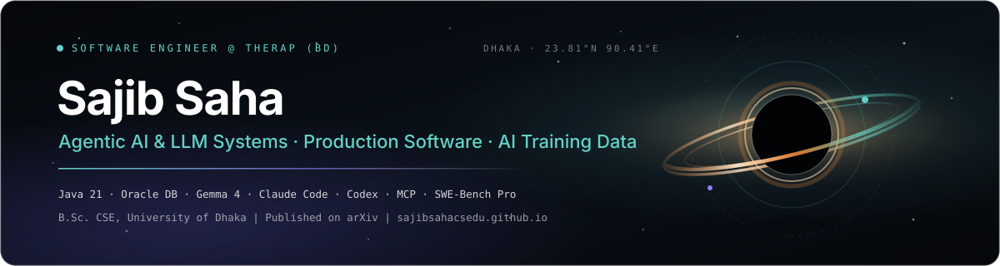

  

    

  
  
  
  
  

---

### About Me

Software Engineer at **[Therap (BD) Ltd.](https://therapbd.com/)** and Computer Science & Engineering graduate of the **University of Dhaka** (Dhaka, Bangladesh).

- **Production Healthcare Engineering:** Building and maintaining safety-critical modules — **ISP** (Individual Support Plan), **MAR** (Medication Administration Record), and **health-tracking** — using **Java 21** and **Oracle DB**.
- **Open-Weight LLM Agents:** Developing a **Gemma 4** data agent connected to application records so clinicians and caregivers can query data in natural language.
- **Agent-First Daily Workflow:** Running multi-agent orchestration across **Claude Code**, **OpenAI Codex**, and **Google Antigravity** — authoring custom **Claude Skills**, wiring internal **MCP servers**, and auditing AI-generated patches before merge.
- **Benchmarking, Research & AI Training Data:** Evaluating coding agents on **SWE-Bench Pro** & **Terminal-Bench 2.0**, curating polygon/bounding-box computer-vision datasets, and publishing deep-learning research on **[arXiv](https://arxiv.org/abs/2510.03797)**.

---

### Coding-Agent Evaluation Snapshot

Independent evaluation benchmarking coding agents across real-world software engineering and terminal workflows:

| Benchmark | Setup | Claude Haiku 4.5 | Claude Haiku 5.5 | Gain |
| :--- | :--- | :---: | :---: | :---: |
| **SWE-Bench Pro** | 20-task sample (731-task public set · Python, JS, TS, Go) | `25%` | **`55%`** | **+30 pp** |
| **Terminal-Bench 2.0** | 20-task sample (89 human-verified tasks · Harbor framework) | `30%` | **`65%`** | **+35 pp** |

- Classified **45 failed agent trajectories** by failure mode *(wrong file localization, incomplete multi-file patch, broken tests, environment & tool-use errors)*.
- Authored **3 Dockerized tasks** in Terminal-Bench format (instruction, container environment, verification tests, and oracle solution).
- Benchmarked **Claude Code vs. Codex (GPT-5-mini / GPT-6 Luna)** on identical tasks across resolve rate, cost per task, and steps per task.

---

### Featured Projects & Research

| Project / Paper | Domain | Highlights | Links |
| :--- | :--- | :--- | :--- |
| **Interactive 3D Portfolio** | Next.js · Three.js · TypeScript | Scroll-driven 9-station cosmic WebGL scene, custom GLSL shaders, shadcn/ui, and ATS printable CV | [Live Site](https://sajibsahacsedu.github.io) · [Repo](https://github.com/Sajibsahacsedu/sajibsahacsedu.github.io) |
| **Road Damage & Manhole Detection** | Deep Learning · Computer Vision | Hybrid **CNN + Vision Transformer + YOLO** pipeline trained on custom polygon-labeled Roboflow data | [arXiv](https://arxiv.org/abs/2510.03797) · [GitHub](https://github.com/Sajibsahacsedu/RoadClassification) |
| **Fair Task Offloading for Decentralized MEC** | Multi-Agent Deep RL | **MAPPO** scheduling model optimizing a joint latency–energy–fairness objective with ablation studies | [Code](https://github.com/Sajibsahacsedu/Thesis_code_PPO) · [Results](https://drive.google.com/drive/folders/1mS_sG0YgJd-gbWPjor6uBzbkp8j_25J5?usp=drive_link) |
| **Skill Bridge** | LLM Integration · Web | AI-powered career roadmap & skill-gap recommendation engine with OpenAI CV parsing | [GitHub](https://github.com/Sajibsahacsedu/Skill_Bridge) |
| **ZeroBin** | Full-Stack · Analytics | Smart waste-management ecosystem with PostgreSQL schemas & RBAC KPI dashboards *(Therap JavaFest 2025, 2nd Round)* | [GitHub](https://github.com/Javafest-2025) · [Demo](https://youtu.be/mh8ZIMyFH3w) |
| **NLP, Transformers & MCP Lab** | LLMs · Tool Use | Transformer internals, LLM council & rating experiments, open-source frontier models, and Supabase MCP | [GitHub](https://github.com/Sajibsahacsedu/NLP_Transformer_LLM_Basic) |

---

### Technical Stack

| Area | Technologies |
| :--- | :--- |
| **Languages** | Java (21), Python, SQL, TypeScript / JavaScript, C / C++ |
| **Backend & Web** | FastAPI, Next.js, Prisma ORM, Supabase, REST API Design, SSLCommerz |
| **Databases** | Oracle Database, PostgreSQL, MySQL |
| **Agentic Coding** | Claude Code, OpenAI Codex, Google Antigravity, Multi-Agent Orchestration, MCP Servers, Claude Skills |
| **LLMs & Evaluation** | Gemma 4, OpenAI API, VLM Run Orion, SWE-Bench Pro, Terminal-Bench 2.0, Harbor, Docker Harnesses, LLM Code Review |
| **ML & Data Annotation** | Pandas, Scikit-learn, CNN, Vision Transformer, YOLO, MAPPO, Polygon & BBox Labeling, Roboflow, Label QA |
| **Tools & Testing** | Git / GitHub, Linux, Docker, Postman, Playwright, Appium, Jupyter |

---

### Education & Recognition

- **University of Dhaka** — B.Sc. in Computer Science and Engineering *(Jan 2022 – May 2026)*
- **Published Author** — Deep-learning paper on road damage & manhole detection *([arXiv:2510.03797](https://arxiv.org/abs/2510.03797), 2025)*
- **10th Place** — IIUC AI Hackathon *(out of 100+ teams, computer vision & AI challenges)*
- **Finalist** — UAP Hackathon  ·  **2nd Round Selection** — Therap JavaFest 2025

---

  Open to collaborations in software engineering, agentic AI systems, coding-agent evaluation, and LLM training data. 
  <a href="https://sajibsahacsedu.github.io"><b>sajibsahacsedu.github.io</b></a> · <a href="mailto:sajibsaha3464@gmail.com">sajibsaha3464@gmail.com</a>

